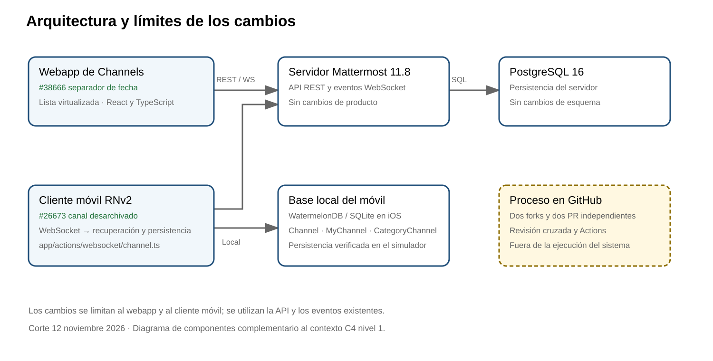

# Segundo avance del proyecto Mattermost

Corte 12 de noviembre de 2026. Equipo: Franklin Castro Rodríguez, Sofía Tenorio Mata y Gabriel Lobo Ulloa. CENFOTEC, C3-PSWE, docente Shirley Ramírez Cordero.

## Documentos y evidencias

- [PDF consolidado de 14 páginas](https://drive.google.com/file/d/1k2-waZGNoF3Sk-deFlokiS607USTubCU/view)
- [Word editable con el formato del documento de Franklin](https://docs.google.com/document/d/1k-GKGCn7Y5BS5ikV3J9rU4elrL81a7l3/edit?rtpof=true)
- [Reporte individual de Gabriel con el formato de Sofía](https://docs.google.com/document/d/1GQYfsndc3shsyftyCADrfr9dDTwyje8eiE7aP4bjT8U/edit)
- [Capturas, videos y controles web](https://drive.google.com/file/d/1hhePpnIPYFrjJlU-CxyHRDWcuyGUj5Sj/view)
- [Evidencia móvil y logs de CI](https://drive.google.com/file/d/18FV-TzinZNxF672eYtuyFN9tWbH0NWJm/view)

Los documentos originales se conservaron. El PDF incluye alcance, proceso, plan con responsables, dificultades, riesgos, modelo de costos, seis métricas con método y umbral, arquitectura, registro de IA y coevaluación 10/10 acordada por el equipo. Los costos sin medición permanecen sin cuantificar.

## Trazabilidad de los dos cambios

| Dato | Web #38666 | Móvil #26673 |
|---|---|---|
| Fork | [mattermost](https://github.com/thegabrielobo/mattermost) | [mattermost-mobile](https://github.com/thegabrielobo/mattermost-mobile) |
| Base de producto | e8bd2b8a871cbeff6943bead62328478118188df, v11.8.0 | 7a46711d3520a8466e011e8fbcf13e91730205b0, snapshot 2.46.0 |
| Rama | GH-38666-sticky-date-divider | GH-26673-unarchived-channel-list |
| Commit de implementación | 40c673451fe14a6914567d9cb9a8256860db1439 | 13d63e6ca319c601dac09ee35ddd55700252725c |
| PR | [Web #1](https://github.com/thegabrielobo/mattermost/pull/1), base pswe07-base | [Móvil #1](https://github.com/thegabrielobo/mattermost-mobile/pull/1), borrador hacia main |
| CI académico | [43106817272](https://github.com/thegabrielobo/mattermost/actions/runs/43106817272) aprobado | [43101844095](https://github.com/thegabrielobo/mattermost-mobile/actions/runs/43101844095) aprobado |
| Pruebas | Base35/36; corregido36/36 | Corregido137/137 en tres suites |
| Validación de interfaz | Ejecutada; síntoma original inconcluso | Base no recupera; cambio aparece y permite abrir sin recarga |

El PR web añade el workflow académico en ca040a6e03401dcb0f1674a91752b0b39a665c4d, sin modificar la implementación original de Sofía. El CI web general también pasó sus doce jobs en [43106817307](https://github.com/thegabrielobo/mattermost/actions/runs/43106817307). En móvil pasó el workflow heredado ci; E2E label manager falló por un secreto ausente y no se cuenta como prueba de producto aprobada.

## Resultado visual web

[Ensayo real 43276950292](https://github.com/thegabrielobo/mattermost/actions/runs/43276950292), commit de QA 0816093d9e50bf0d5b7217ec3660fca97138892c, artefacto13972175777. Rama de QA separada de los PR de producto. Mattermost11.8, PostgreSQL16, Chromium/Playwright1.62.1, viewport390×844, dos canales de dos días y control de un día; seis cargas y cuatro cambios de canal por versión. El scroll manual, el regreso al final y escritorio1280×900 conservaron el comportamiento ensayado.

La base mostró el indicador inicial durante106–117 fotogramas y la corrección no lo activó en las diez entradas. No apareció una fecha anterior visible en la base: **la reproducción del síntoma original sigue inconclusa**, aunque se comprobó el efecto del guard. Ambas fases registraron ocho errores de cuenta/equipo con el mismo mensaje, conservados en sus JSON. No se probó Safari ni un dispositivo físico. Las capturas y videos son reales; no se forzó el estado del componente.

## Resultado nativo móvil

Se archivó el canal antes del login para comprobar su ausencia local. Con WebSocket activo, la base mantuvo0 filas de canal y membresía después de restaurar; Gabriel confirmó que no apareció. El cambio dejó Channel=1, MyChannel=1 y CategoryChannel=1; Gabriel confirmó que apareció y pudo abrirlo sin recarga. Las dos evidencias JSON registran el mismo canal y la verificación SQLite de solo lectura. No se conservaron capturas o video de esa interfaz ni se hizo un ensayo adicional de cerrar y reabrir.

## Arquitectura como código

- [C4 nivel1 contexto Mermaid](arquitectura-contexto.mmd) y [draw.io editable](arquitectura-contexto.drawio). Mattermost aparece como un sistema único con sus personas usuarias; no se confunden componentes internos con sistemas externos.
- [Componentes Mermaid](arquitectura-componentes.mmd), [draw.io editable](arquitectura-componentes.drawio) y [SVG](arquitectura-componentes.svg). Detalla los dos clientes, API/WS, SQLite local y PostgreSQL. El proceso de GitHub queda separado de la ejecución.

## Pendientes reales

Sofía debe revisar el PR móvil. Los PR no fueron aprobados ni fusionados. El síntoma visual original web requiere una reproducción concluyente o una aceptación académica explícita de su limitación. Los issues mantienen su estado público (web cerrado, móvil abierto/asignado); no se presume aprobación docente. La entrega humana en Moodle y la defensa final no se certifican en este corte.

Codex apoyó análisis, código móvil, pruebas, CI, diagnóstico y documentación. Gabriel operó y confirmó la interfaz iOS. Las evidencias versionadas no contienen contraseñas ni tokens de sesión.
